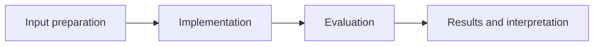

# Auditable Data Analysis Agent

**Feras Elghandour** · Technical case study

Route natural-language data questions to explicit tools and keep the executed steps, cache behavior, and errors inspectable.

## Implementation

A deterministic tool router with dataset statistics, correlation analysis, bounded arithmetic parsing, working memory, and an in-memory audit trail.



## Evidence and results

The release fixes the recorded shell-weight column-resolution error and replaces unrestricted expression evaluation with an allowlisted AST interpreter. Regression tests cover both failures and the supported query paths.

Results described as saved come from the retained experiment record. See [VALIDATION.md](VALIDATION.md) for the checks performed on this release and their scope.

## Fresh reproduction — October 17, 2026

Fresh execution completed the demonstration and both column-resolution and bounded-calculation regression checks.

The environment versions, input hashes, and notebook hash are recorded in [results/reproduction.json](results/reproduction.json).


## Practical relevance

This project demonstrates a deterministic tool router with dataset statistics, correlation analysis, bounded arithmetic parsing, working memory, and an in-memory audit trail.
The implementation and evaluation make the trade-offs inspectable for technical review.

## Run locally

```sh
python -m venv .venv
source .venv/bin/activate
python -m pip install -r requirements.txt
jupyter lab analysis.ipynb
```

Prepare the inputs described in [DATA.md](DATA.md) first. Source validation is available without installing model dependencies:

```sh
python scripts/validate_source.py
```

Run the focused offline behavior checks with `python smoke_test.py` after installing the dependencies.

## Limitations

The router is rule-based and is not a general reasoning model. Keyword scope checks are limited and the in-memory trace is not a tamper-proof persistent audit log.

## Development

Changes should include a clear description of the behavior affected and verification appropriate to that behavior. Keep input data, credentials, model caches, and generated artifacts outside version control.
