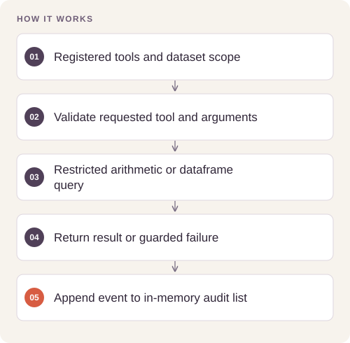
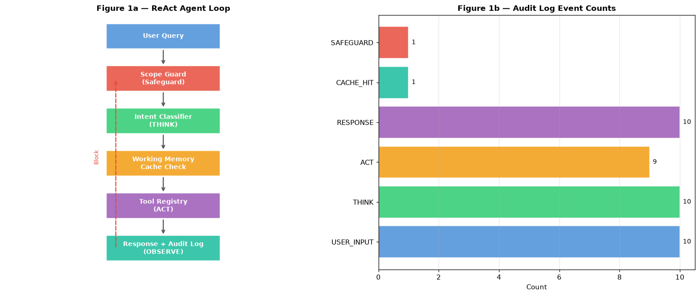

# Auditable Data Analysis Agent

Route natural-language data questions to explicit tools and keep the executed steps, cache behavior, and errors inspectable.

## Implementation

A deterministic tool router with dataset statistics, correlation analysis, bounded arithmetic parsing, working memory, and an in-memory audit trail.



## Try a small example

A small offline fixture exercises the public implementation. It demonstrates the behavior shown below; it does not replace the historical dataset, benchmark or production validation.

After the local setup below, run from the repository root:

```sh
python examples/quickstart.py
```

The [example source](examples/quickstart.py), [captured output](examples/expected-output.txt) and [execution record](examples/environment.json) keep this demonstration inspectable. Floating-point values may vary with library versions.

Observed output from this run:

```text
{
  "fixture": "three generated abalone rows",
  "calculation": "Result: 12.0",
  "female_shell": "Mean Shell_weight for female: 0.3  (n=2)",
  "blocked_expression": "Error evaluating expression: unsupported expression"
}
```

## Evidence and results

The release fixes the recorded shell-weight column-resolution error and replaces unrestricted expression evaluation with an allowlisted AST interpreter. Regression tests cover both failures and the supported query paths.

See [VALIDATION.md](VALIDATION.md) for the release checks and their scope.

## Fresh reproduction — October 17, 2026

Fresh execution completed the demonstration and both column-resolution and bounded-calculation regression checks.

The environment versions, input hashes, and notebook hash are recorded in [results/reproduction.json](results/reproduction.json).



## Run locally

```sh
python -m venv .venv
source .venv/bin/activate
python -m pip install -r requirements.txt
jupyter lab analysis.ipynb
```

Prepare the inputs described in [DATA.md](DATA.md) first. Source validation is available without installing model dependencies:

```sh
python scripts/validate_source.py
```

Run the focused offline behavior checks with `python smoke_test.py` after installing the dependencies.

## Limitations

The router is rule-based and is not a general reasoning model. Keyword scope checks are limited and the in-memory trace is not a tamper-proof persistent audit log.
